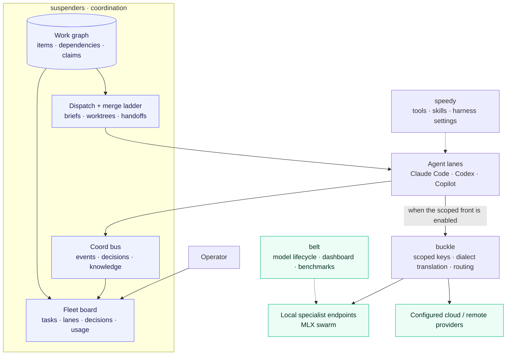
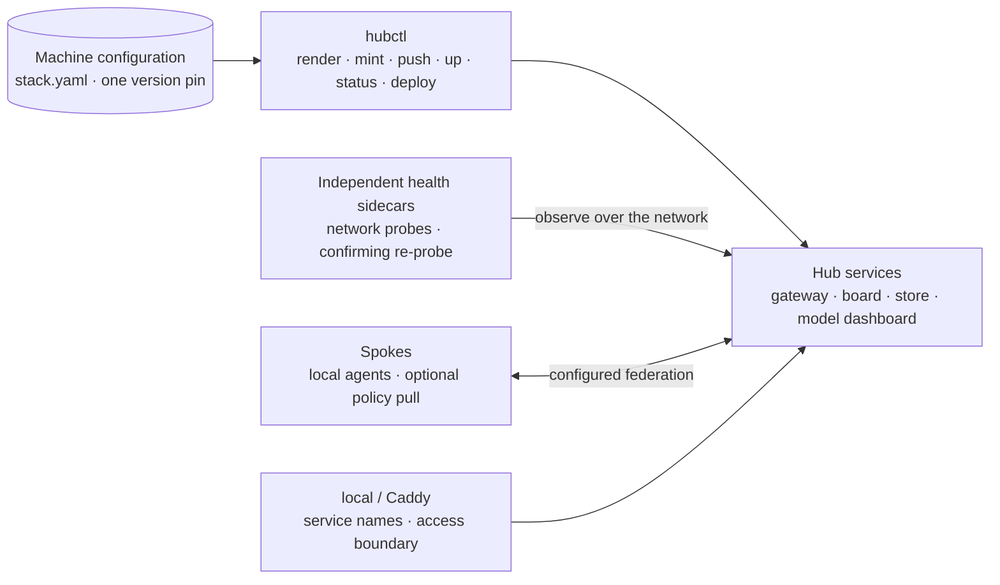

<div align="center">

# fleet

### The agentverse agent stack

**Give agents work. Keep them coordinated. Route their models. See what happened.**

Fleet is one monorepo for operating coding agents as a fleet: a work graph
that owns every task, a coordination plane that settles decisions, a gateway
that governs every model call, and a board that shows what happened.

[Examples](#what-you-can-do-with-fleet) · [The stack](#the-stack) ·
[Architecture](#how-it-fits-together) · [Get started](#get-started) ·
[Operations](#everyday-operations) · [Status](#status) ·
[Benchmarks](benchmarks.md)

</div>

---

## Why

One developer running many agents needs an operator's plane, not more chat
windows. Work needs an identity and one ledger. Lanes need claims, leases and
credentials. Model access needs policy. Finished items need commit evidence.
Fleet is that plane: coordinate coding agents on shared repositories, run
specialist models on Apple Silicon, or operate hubs with connected spokes.
Local inference, cloud providers and federation are configurable parts of the
stack, never prerequisites.

## What you can do with Fleet

### On one Mac: deliver a feature with several coding agents

You want pagination in an API, tests for edge cases and a matching UI.
Register the goal, split independent work into lanes and follow the board.
Each lane works in its own worktree, carries a brief and checkpoints its
progress; the merge ladder integrates the branches.

```sh
work add "Add pagination to the orders API" --desc "Bounded paging; preserve response fields; test empty and final pages."
work ready
dispatch --dry-run --target 1
coord fleet
```

If two agents need the same file, the governor protects the current holder's
lease; a repeated conflict requests one targeted consultation instead of
identical requests. After the asker tests an answer, verified knowledge helps
the next lane facing the same scoped problem. Use your lane ID and the
returned consult ID:

```sh
coord consult --best "How does this API preserve cursor compatibility?" --scope "src/api/orders" --as "$LANE_ID"
coord consult-reply "$CONSULT_ID" --feedback resolved --evidence "Compatibility tests passed; existing cursors still work" --as "$LANE_ID"
coord kb stats
```

Local MLX specialists serve extraction, reranking and coding work, with
configured cloud routes for the rest. The model supervisor adopts running
services, probes them and recovers with restart budgets, backoff and
dependency checks. A capsule lets a replacement lane resume work after a
process dies.

### With distributed hubs: use a remote gateway from a developer laptop

Your laptop runs the agent tools while a configured desktop or NAS hub
provides model access, a board or a shared coordination store. Hub addresses,
ports and credentials live in machine configuration. A project pins its hub
with a repo `.prefer` file (`hub=LAB`, where `LAB` exists in the operator's
hub registry), which selects the gateway destination while the agent process
and checkout stay local. To inspect a profile without deploying it:
`bun packages/suspenders/deploy/hubctl.ts render "$HUB"` and
`bun packages/suspenders/deploy/hubctl.ts status "$HUB"`.

A developer can use local specialists for small jobs and a remote gateway for
larger requests, while the gateway applies routing policy and credentials.
Independent health sidecars report network failures even when the service they
monitor is down. Governor consultations drain to a configured remote hub
through the durable consult outbox relay. Cross-hub visibility and origin
attribution: the
[federation architecture](docs/upstream-observability-architecture.md).

Sharing a coordination store requires matching project identity. Enrollment
stages for cross-clone identity have landed; a migration verb for existing
graphs and writer-side enforcement remain open
([cross-hub project identity](docs/cross-hub-project-identity.md),
[October 2026 audit](docs/md-corpus-audit-w693.md)).

### In an enterprise: coordinate a shared service-health policy

A platform team wants every API to have an independent health reporter that
survives the API process stopping. Fleet can carry the work: give agents the
policy and acceptance criteria, register remediation items, assign lanes,
surface decisions and retain commit evidence. Reuse the existing probe
sidecar where it meets the deployment contract.

The intended workflow: assess each service once per relevant code or
configuration version, share the assessment across authorized teams and
propose missing reporters to developers. Verification distinguishes a merged
patch from a reporter actually deployed and serving. Upstream hubs show the
lanes they serve, filtered so operators inspect one team, not every lane.

**Available building blocks:** work tracking, agent guidance, consultations,
commit evidence, scoped gateway keys, independent probes, configured routing.
**Enterprise design work:** shared cross-clone identity, tenant-aware
authorization, policy assessment and deduplication, approved knowledge
sharing, cross-hub observability. An `AGENTS.md` instruction guides agents;
it does not enforce corporate policy. The private enterprise tier
(klh-remote) is a separate local-only overlay outside this checkout.
Boundaries and rollout design:
[health-policy scenario](docs/research-toto-gpt.md#design-refinement-make-policy-a-shared-workflow-not-repeated-instructions),
[cross-hub project identity](docs/cross-hub-project-identity.md),
[upstream observability architecture](docs/upstream-observability-architecture.md).

## The stack

| Package                                | Responsibility                     | What lives there                                                                                                                                                                                                                                          |
| :------------------------------------- | :--------------------------------- | :-------------------------------------------------------------------------------------------------------------------------------------------------------------------------------------------------------------------------------------------------------- |
| **[suspenders](packages/suspenders/)** | Coordinate the agents              | SQLite work graph, claims and leases, coordination bus, decisions, knowledge, hook gates, dispatch, merge ladder, fleet board, hub tooling                                                                                                                |
| **[buckle](packages/buckle/)**         | Govern model access                | Two client wire dialects (OpenAI, Anthropic) over a LiteLLM-internal engine and a 100+ provider catalog carried as data rows, native dialect translation, routing ladders with retries and cooldowns, scoped `bksk_` keys, usage ledger, governance seams |
| **[belt](packages/belt/)**             | Operate the model fleet            | Specialist registry, MLX lifecycle and routing, remote discovery, dashboard, evaluation and benchmark tools                                                                                                                                               |
| **[speedy](packages/speedy/)**         | Equip the developer environment    | CLI speed tools, curated skills, personas, commands, agents, hooks, settings, statusline, install.sh and harness configuration                                                                                                                            |
| **[local](packages/local/)**           | Give services a local front        | Caddy registration, Bonjour/mDNS names, loopback defaults, authenticated LAN exposure, service registry and bar dashboard                                                                                                                                 |
| **[local-llm](packages/local-llm/)**   | Ship the shared inference kit      | Flat runtime kit and config templates (env, routing ladder, memory policy); the model inventory, supervisor and Anthropic-wire router are belt-owned re-exports                                                                                           |
| **[blam](packages/blam/)**             | Study and reproduce agent failures | CRASH taxonomy, sanitized incident dataset, deterministic LLM-optional benchmark scenarios, labeling tools, and the shared prompt-condense engine                                                                                                         |

The boundaries matter: **suspenders assigns and tracks work; buckle controls
LLM requests; belt operates the model fleet; speedy configures the agent
environment.** `local` supplies service access; BLAM supplies failure
evidence.

## How it fits together



This is a responsibility map. Runtime policy chooses the route: the local
router and LiteLLM remain part of existing installations, and dispatch falls
back to belt directly when the buckle front or admin credential is missing.

### From a goal to a commit

1. **Register the work.** The work graph holds the task, dependencies,
   priority and executor preferences; missions can split.
2. **Dispatch a lane.** A claim, worktree, brief and resume context identify
   the work. Where configured, dispatch mints a revocable `bksk_` credential
   and routes through `/w/<sid>` for attribution.
3. **Coordinate as it runs.** WebSocket subscriptions carry events and
   consultations; decisions and durable facts belong in the coordination
   plane.
4. **Check and integrate.** Hook gates enforce quality and edit rules; the
   merge ladder integrates branches. Closure records commit evidence, and
   reclaim verbs recover claims from dead lanes.

The board also exposes orchestration previews and prompt settings; condensing
delegates to BLAM's engine, and model enhancement has an endpoint fallback.

### From one machine to hubs and spokes



Hub profiles supply ports, binds, transports and secret paths. The version
pin in `stack.yaml` selects the same git ref every hub pulls, and hub
containers mount git-pulled volumes, never host paths. Health comes from a
separate probe process with consecutive-miss handling and an active
confirmation before declaring a target down. The compose template mounts this
checkout's `packages/` trees; `hubctl deploy <hub>` runs the whole chain
(mint, push, up, status). More:
[hub deployment](packages/suspenders/deploy/README.md),
[example configuration](packages/suspenders/deploy/stack.example.yaml).

## Get started

**Requirements depend on the layer.** TypeScript tools use Bun; the root
manifest requires Bun >= 1.2. Installers and the local service front target
macOS. MLX needs Apple Silicon and memory for the chosen tier. Hubs use
Docker Compose.

### Explore and test the source

```sh
git clone https://github.com/klh/fleet.git
cd fleet

# Resolve the monorepo workspace from its root lockfile.
bun install --frozen-lockfile

# Focused checks of shared condensing, board transforms and lane credentials.
bun test packages/blam/test/condense.test.ts packages/suspenders/test/prompt-transform.test.ts packages/suspenders/test/lane-auth.test.ts

# Run the board from the checkout.
bun packages/suspenders/hooks/bin/fleet-board.ts
```

The board defaults to port **7799**. Package READMEs describe individual
tools; the original repos are archived and push-dead, and every change
lands here at `packages/<name>/`.

### Inspect the installer before activation

```sh
bash packages/suspenders/install.sh --dry-run
```

`install.sh` is a thin wrapper over the native installer
(`bun scripts/install.ts`). Documented flags include `--wire`,
`--with-launchd`, `--skip-models`, `--no-llm`, `--profile hub|spoke`,
`--prune`, `--step`, `--json`, `--yes` and `--hub <name>`, with
`SUSPENDERS_PREFIX` and `SUSPENDERS_SHIM_BIN` overrides. The default plan
attempts model downloads; `--skip-models` and `--no-llm` skip those.
`--hub <name>` runs the one-shot hub deploy against the machine `stack.yaml`.

For a fleet-wide install across packages, speedy ships the umbrella installer
(`packages/speedy/bin/install-fleet.ts`), which defaults to this repository.

## Everyday operations

PATH shims expose the command surfaces; every verb has `--help`.

| Need                             | Command                                                       |
| :------------------------------- | :------------------------------------------------------------ |
| See claimable work               | `work ready`                                                  |
| Inspect an item                  | `work show <id>`                                              |
| Claim and close with evidence    | `work take <id> --as <sid>` / `work done <id> --sha <commit>` |
| Recover dead claims              | `work reclaim all`                                            |
| See fleet activity               | `coord fleet`                                                 |
| Subscribe to coordination events | `coord subscribe --as <sid>`                                  |
| Ask the fleet a scoped question  | `coord consult --best "<question>" --as <sid>`                |
| Retrieve a durable lesson        | `coord fact get lesson.<topic>`                               |
| Dispatch work                    | `dispatch --dry-run --target <N>` / `dispatch --item <id>`    |
| Ask the named reviewer           | `oracle review`                                               |
| Hub render / status / deploy     | `bun packages/suspenders/deploy/hubctl.ts <verb> <hub>`       |

### Runtime configuration

Real hosts and credentials live outside the repository; committed config
supplies examples and defaults.

| Location                                  | Purpose                                                     |
| :---------------------------------------- | :---------------------------------------------------------- |
| `~/.config/klh/stack.yaml`                | Hub profiles, deployment settings and the stack version pin |
| `~/.claude/local-llm/belt.env`            | Runtime provider settings and buckle admin credential       |
| `~/.claude/local-llm/hubs.json`           | Hub labels and candidate URLs                               |
| `~/.claude/local-llm/routing-policy.yaml` | Operator-owned routing ladder                               |
| `~/.claude/local-llm/upstreams.yaml`      | Runtime upstream group overrides                            |
| `~/.claude/local-llm/buckle-spoke.env`    | Spoke bootstrap credential                                  |

Keep secret-bearing files mode **0600**. Root keys are generated on the target
device; admin and lane keys are minted through the gateway API, audited and
revocable. Example ports in package docs are not universal settings.

## Engineering principles

- **One stack version.** The version pin in `stack.yaml` selects the same ref
  across deployed services; hubctl renders it as the ref every hub pulls.
- **One work ledger.** Tasks and claims belong in the work graph; docs explain
  architecture and decisions. Project identity follows the Git common
  directory.
- **Independent health.** Sidecars observe real network responses outside the
  served process; a service cannot paint itself healthy.
- **Config over code.** Machine facts and secrets stay in runtime
  configuration; repositories carry placeholders only.
- **Secrets are minted, never typed.** Root keys are generated on the target
  device; lane keys are scoped, revocable and audited.
- **Streams by default.** Streaming HTTP/SSE, NDJSON feeds and bounded rings
  keep asynchronous work from becoming unbounded buffers.
- **Quality at the edit boundary.** qlty is the quality surface, Biome owns
  code formatting and Prettier owns Markdown. TypeScript files have a
  1500-line limit.
- **Lit and design tokens.** Never `innerHTML`, never `document.write`;
  native elements first, vendored assets for offline use. The board UI is
  Lit templates; its string-rendering era is retired.

## Status

This checkout is the single living repo: the original package repositories are
archived and push-dead, and all changes land here at `packages/<name>/`.
Deeper records: the [monorepo review](docs/monorepo-review-2026-10-05.md)
and the [corpus audit](docs/md-corpus-audit-w693.md).

Landed:

- Root workspace (`packages/*`) with a shared lockfile; all seven packages
  carry manifests.
- Root CI workflow: per-package matrix, entrypoint parse-check, installer
  round-trip, runtime SQLite job.
- Hub deployment from this checkout: compose mounts `packages/` paths;
  `hubctl deploy` is the one-shot chain (mint, push, up, status).
- The umbrella installer defaults to this repository; `bash install.sh` from
  `packages/suspenders` remains the only repo-to-prefix sync.

Open:

- NAS hub flip: gated on a pending owner decision
  (`docs/md-corpus-audit-w693.md`, NEED_DECISION #30282).
- Cross-clone identity: a migration verb for existing graphs and
  writer-side enforcement are still design work.
- The enterprise overlay (klh-remote) is local-only until its GitHub push.

The work graph is the live ledger for everything else: run `work ready` or
read the board rather than trusting this list.

## Evidence and benchmarks

[**benchmarks.md**](benchmarks.md) holds the consolidated measurement table:
model serving, routing, stack-versus-direct API comparisons and prompt
transforms. Rows are decision-grade, medians decide and quality claims need
large paired samples. Raw belt measurements:
[benchmarks.jsonl](packages/belt/bench/benchmarks.jsonl).

[**doesnt_work.md**](doesnt_work.md) is the negative-results ledger: tried
optimizations that did not deliver, with the failure mechanism and the rule
that replaced them.

BLAM adds the **CRASH** failure taxonomy: Concurrency races, Recovery gaps,
Alignment drift, State poisoning and Handoff failures. Core scenarios use
scripted lane stand-ins, so failure reproduction runs without model calls.
See the [taxonomy](packages/blam/docs/taxonomy.md),
[benchmark harness](packages/blam/bench/).

## Licensing

Licenses are package-specific. All seven packages carry the PolyForm
Noncommercial License 1.0.0. BLAM's dataset has a separate CC-BY-4.0 notice,
and LiteLLM provider docs vendored under buckle remain MIT. Consult each
package's `LICENSE` rather than assuming one license for the stack.

---

<div align="center">

A [Threads](http://www.threads.dk) thing.

</div>
