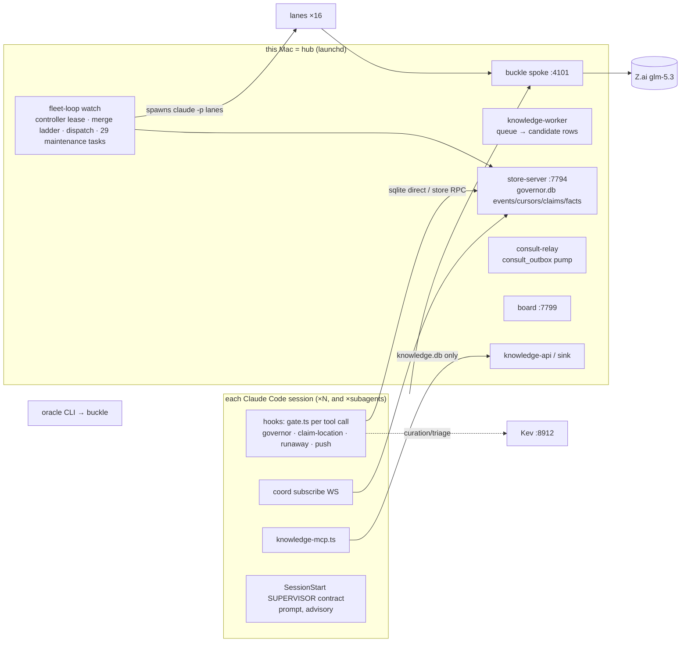

# Hub control plane — current state, consult/knowledge design, hub-of-one

Status: proposal (2026-10-29). Builds on, does not replace,
[W1124.18.2](w1124.18.2-capability-advertised-hub-execution-plan.md) (one
authoritative hub per project, lease-fenced handoff). Evidence = code reads
with file:line, plus live process/metric counts taken 2026-10-29 ~13:50 CET.

## 0. Principle

**Every install is a hub. A single machine is a hub of one.** One code path:
the CLI session is a thin client of _its_ hub (loopback on a solo Mac, the
NAS/desktop hub on a spoke). Supervisor, governor service, consult router,
oracle, Kev and the knowledge store run **once per hub** — never once per
session. Federation is hub↔hub, never session↔session.

## 1. Current state — the moving parts



| Part           | What it is today                                                                                                                                                                                                                                                                                                                                             | Where                                                                                                         |
| -------------- | ------------------------------------------------------------------------------------------------------------------------------------------------------------------------------------------------------------------------------------------------------------------------------------------------------------------------------------------------------------ | ------------------------------------------------------------------------------------------------------------- |
| **Supervisor** | The name covers six things: (a) a SessionStart _prompt contract_ injected into every non-lane session, advisory ("observer, not controller"); (b) the real controller = `fleet-loop watch` holding a `controller_leases` row; (c) launchd plane `coord supervisor`; (d) `scripts/supervise.ts` micro-supervisor; (e) the merge ladder; (f) dispatch-watchdog | `hooks/lib/lanes/supervisor-refill.ts:43`, `scripts/lib/controller-fence.ts`, `hooks/lib/fleet-loop/merge.ts` |
| **Governor**   | Not a service. `governor.db` = the whole control-plane store; "the governor" = a hook gate (area claims + 15-min per-file leases) re-run in a fresh `bun` on every tool call of every session                                                                                                                                                                | `hooks/gates/governor.ts:47`, `hooks/gates/chain.ts:15`                                                       |
| **Dispatch**   | Three spawn paths (`dispatch-next.ts`→lane-launch, `fleet-loop/dispatch.ts` hand-rolled argv, `supervise.ts`). Cap `stack.json fleet_loop.lane_target`. The allocate scorer is unused by refill                                                                                                                                                              | `hooks/lib/stack-config.ts:403`, `hooks/lib/fleet-loop/dispatch.ts:484`                                       |
| **Coord bus**  | store-server WS `/subscribe`; events, cursors, inbox, ack; `message`/`steer`/`BROADCAST` = events                                                                                                                                                                                                                                                            | `hooks/bin/store-server.ts:480`, `hooks/coord/bus.ts`                                                         |
| **Consult**    | Sequence: lesson guidance (advisory) → verified `consult_kb` hit (only with `--scope` + version) → verified fact hit → one expert sid (`--best`) → optional hub leg → REFUSED                                                                                                                                                                                | `hooks/coord/consult.ts:49-357`, `hooks/coord/shared.ts:110-273`                                              |
| **Knowledge**  | `knowledge.db` (candidate→active→retired/graveyard, source_hash trust) plus knowledge-shaped rows in governor.db `facts` (`lesson.*`, `finding.*`, `claim.*`) plus `consult_kb`, plus speedy's separate context-rag recall                                                                                                                                   | `hooks/lib/knowledge/govdb-knowledge.ts:70`, `packages/speedy/hooks/insight-recall.ts:27`                     |
| **Kev**        | Advisory typed classifier (:8912, direct, bypasses buckle): store/noise/review curation on work done / capsule / consult-reply; steer-vs-redo; ask-gate self-vs-coord; coordinate ask/skip                                                                                                                                                                   | `hooks/lib/knowledge/kev-curation.ts:27`, `hooks/lib/knowledge/kev.ts:89`                                     |
| **Oracle**     | Explicit-invoke review CLI (review/bugs/analyze/panel) via buckle hints. No role in consults or knowledge                                                                                                                                                                                                                                                    | `hooks/bin/oracle.ts`, `hooks/lib/hub/oracle-legs.ts`                                                         |

### 1.1 Measured per-session footprint (2026-10-29)

18 claude sessions → 100 bun processes total:

- `coord subscribe` WS: **one per session AND one per subagent** (14 live;
  this session's 3 Explore subagents each got one).
- `knowledge-mcp.ts`: one per session (6).
- `gate.ts`: a fresh process per tool call per session (12 in flight at
  the sample). Every one opens governor.db.
- Leaked lane/test processes still running: `knowledge-api`×6 + `probe`×2
  from `.worktrees/W2214`, `server.ts`×5 from `.worktrees/W2208`,
  `coord-worker`×3 (expected 1), test-fixture sids `parent-sess-11111111`
  subscribed to the **live** store.

The supervisor and governor are not processes per session. The real
multiplier is the **SUPERVISOR contract in every interactive session** plus
**16 live lanes against a `lane_target` of 8**. All of them share one Z.ai
quota through one spoke: since spoke boot, 1812 errored vs ~2300 served,
1420 upstream 429s.

### 1.2 Defects found while mapping (verified)

| #   | Defect                                                                                                                                                                                                                                                                    | Evidence                                                                                                                  |
| --- | ------------------------------------------------------------------------------------------------------------------------------------------------------------------------------------------------------------------------------------------------------------------------- | ------------------------------------------------------------------------------------------------------------------------- |
| D1  | Knowledge search silently skips 2 of 3 stores: `makeStore()` opens knowledge.db only, then queries `facts_fts`/`consult_kb_fts`, which live in governor.db; the error is swallowed. Affects `read_knowledge` MCP, `coord knowledge`, consult `factLookup`, sink `/search` | `lib/knowledge/sqlite-store.ts:821`, `lib/knowledge/knowledge.ts:290-319`; knowledge.db snapshot has none of those tables |
| D2  | `coord gc` is never scheduled, and `archiveAndPrune` cannot finish with more than 500 stale rows (re-selects the same LIMIT batch; DELETE runs after the loop). governor.db = 980 MB; `deltas` = 596 MB                                                                   | `lib/govdb/retention.ts:56-77`; no gc task in `lib/fleet-loop/maintenance.ts`                                             |
| D3  | Telemetry lives in `facts` (FTS-indexed, delta-logged): `harvest.*` ~36k/day, `metrics.*` ~27k/day, `deadletter.*` ~20k/day, `executor.*.cv`                                                                                                                              | `bin/harvest.ts:55`, `lib/work/work-timing.ts:287`, `bin/monitor.ts:287`, `lib/executors/executor-cv.ts:164`              |
| D4  | 16 live lanes vs `lane_target: 8`                                                                                                                                                                                                                                         | `work lanes` live count vs `~/.config/klh/stack.json`                                                                     |
| D5  | No server for `/v1/consult` — the hub consult leg is client-only                                                                                                                                                                                                          | `lib/federation/consult-federation-hub.ts:99`                                                                             |
| D6  | No fleet-wide consult fan-out; `--best` = one sid                                                                                                                                                                                                                         | `coord/shared.ts:273`                                                                                                     |
| D7  | Kev curation timeout 1.5 s vs ~40 s cold start ⇒ mostly `unavailable` ⇒ fail-open                                                                                                                                                                                         | `lib/work/completion-curation.ts:25`, `lib/knowledge/kev.ts:13`                                                           |
| D8  | `knowledge-sync` ships `lesson.seen.<sid>` markers to the hub as candidate knowledge                                                                                                                                                                                      | `lib/knowledge/knowledge-sync.ts:222,329`                                                                                 |
| D9  | Promote has no human/actor gate; recall ranks candidate = active                                                                                                                                                                                                          | `coord/knowledge.ts:111`, `lib/knowledge/knowledge.ts:96`                                                                 |
| D10 | Board hang at :7799 (separate session; not DB size — a scratch board on the same 980 MB snapshot answers in 9 ms)                                                                                                                                                         | in progress                                                                                                               |

## 2. Target — consult and knowledge (owner spec 2026-10-29)

Owner rules:

1. A **consult** is one of three things: something _asked_, something
   _communicated_, or _end-of-lane knowledge_ being stored.
2. **Kev decides relevance**: is this durable knowledge or not. Only if it is
   relevant does it land in **knowledge.db**.
3. Lanes consult **each other, the fleet, or the hub**; lanes can answer;
   lanes can also consult **knowledge** directly.
4. **Every consult passes the oracle**, which checks knowledge for relevant
   lessons before (and alongside) routing.

```mermaid
flowchart TD
  L[lane / session] -->|ask · tell · bank| CI[hub consult ingress<br/>ONE verb, kind=ask|tell|bank]
  CI --> O[oracle: knowledge pre-check<br/>retrieve → Kev relevance rank]
  O -->|confident verified hit| ANS[answer from knowledge<br/>cite rows]
  O -->|lessons, partial| ROUTE
  CI -->|kind=ask| ROUTE{route by target}
  ROUTE -->|sid| PEER[one lane]
  ROUTE -->|fleet| FAN[fan-out to live lanes<br/>first good answer wins]
  ROUTE -->|hub| HUBX[peer hub /v1/consult]
  PEER & FAN & HUBX --> REPLY[reply]
  ANS & REPLY --> K{Kev: durable knowledge?}
  CI -->|kind=tell / bank| K
  K -->|store| KDB[(knowledge.db candidate)]
  K -->|noise| DROP[event only, no knowledge]
  K -->|review / unavailable| Q[review queue — NOT fail-open]
```

Design decisions:

- **One consult verb, three kinds.** `ask` (needs an answer), `tell`
  (communicate; today's `message`/`BROADCAST`), `bank` (end-of-lane or
  capsule knowledge; today's `knowledge-enqueue` and the `work done`
  curation). They share one ingress and one audit trail.
- **The oracle is the consult pre-check, not only a review CLI.** On every
  consult it: retrieves from the _single_ knowledge search (fix D1 first),
  asks Kev to rank relevance against the question (new — today retrieval is
  term overlap only), and attaches the top lessons. It auto-answers only on a
  verified (`hash verified` + `active`) hit. Everything else routes with the
  lessons attached as guidance.
- **Kev gates knowledge.db.** All three kinds end in a Kev store/noise/review
  verdict. `unavailable` goes to a review queue instead of failing open
  (fixes D7). The timeout comes from Kev's warm SLA, with keepwarm owning
  residency.
- **knowledge.db is the only knowledge store.** `lesson.*`, `finding.*`,
  `claim.*` and `consult_kb` migrate into it (states and trust markers
  already exist there). `facts` keeps control-plane state only. Telemetry
  (D3) moves to its own tables or NDJSON, outside FTS and outside the delta
  log.
- **Routing targets** = `sid` | `fleet` | `hub:<name>`. Fleet fan-out is
  bounded (N live lanes, deadline, first verified answer wins, the rest get a
  cancel event). Hub routing needs the missing `/v1/consult` server (D5).
- **Lanes answer** via the same ingress (`reply` to a consult id). Answers
  re-enter Kev curation, so a good answer becomes knowledge once, cited.

## 3. Target — hub-of-one control plane

| Concern                | Today                                                           | Target                                                                                                                                                                                                                                                           |
| ---------------------- | --------------------------------------------------------------- | ---------------------------------------------------------------------------------------------------------------------------------------------------------------------------------------------------------------------------------------------------------------- |
| Supervisor             | Prompt contract in every interactive session + fleet-loop lease | **Hub only.** The fleet-loop controller is _the_ supervisor. Interactive sessions get a _worker_ contract (take/finish your own work, ask via consult); `work report` stays a read-only view anyone can render                                                   |
| Governor               | `gate.ts` cold-starts per tool call, opens governor.db          | Hook = thin client → **hub governor daemon** (loopback socket on a solo machine). Leases, claims, runaway, scrub decided in one warm process; the hook only forwards and enforces the verdict. Fail-closed when the daemon is unreachable, same as the store law |
| Inbox                  | One `coord subscribe` WS per session and per subagent           | **One subscription per machine** (or none for subagents); the daemon fans events out to session logs. Subagents inherit the parent's inbox                                                                                                                       |
| Knowledge MCP          | `knowledge-mcp.ts` per session                                  | MCP shim → hub knowledge face (one search implementation; retire the belt duplicate)                                                                                                                                                                             |
| Consult / oracle / Kev | CLI-side logic + direct Kev calls                               | Hub services behind the consult ingress (§2); Kev rides buckle like every other model call                                                                                                                                                                       |
| Dispatch               | 3 spawn paths, cap exceeded                                     | One path (registry recipe), one cap enforced at spawn time in the controller, quota-aware (429 rate shrinks the target before more lanes start)                                                                                                                  |
| Single machine         | Implicit: all of the above on loopback                          | Explicit: `hub = self`, the same daemons, no peers. A spoke is the same client pointed at a remote hub                                                                                                                                                           |

## 4. Plan — dependency order

Stop the bleeding first, then consolidate, then add the new consult shape.

1. **Hygiene (no design change)**
   - Kill the leaked W2214/W2208 serve processes and test-fixture
     subscribers; teach rogue-reap to catch `.worktrees/*` serve processes
     whose lane is dead.
   - Enforce `lane_target` at spawn (D4); find which path overshoots.
   - Schedule `coord gc` and fix `archiveAndPrune`'s batch loop (D2).
   - Move telemetry out of `facts` (D3); prune `deltas`; VACUUM.
2. **Correctness** — fix D1 (one knowledge search over the right DBs), D7
   (Kev review queue instead of fail-open), D8 (sync filter), D9 (promote
   gate, state-aware ranking).
3. **Single knowledge store** — migrate `lesson.*`/`finding.*`/`claim.*`
   and `consult_kb` into knowledge.db; delete the duplicate belt search.
4. **Consult ingress v2** — one verb (`ask|tell|bank`), oracle pre-check,
   Kev relevance rank, routing `sid|fleet|hub`, `/v1/consult` server (D5),
   bounded fleet fan-out (D6).
5. **Hub governor daemon** — hooks become thin clients; one inbox per
   machine; subagents stop opening subscribers.
6. **Supervisor role** — remove the SUPERVISOR contract from interactive
   sessions; the hub controller is the only supervisor. Aligns with
   W1124.18.2 R3 (dispatch authority lives where the controller lease
   lives).

## 5. Open decisions

- Fleet fan-out answer policy: first verified answer vs best-of-N with an
  oracle judge (costs N× tokens).
- Whether the oracle pre-check may auto-answer from `candidate` rows marked
  `hash verified` (faster) or only from `active` rows (safer).
- Governor daemon transport: extend store-server (one process) or a separate
  hub process (separate failure domain, outside-process health law).
- Whether interactive sessions may still _dispatch_ manually (`dispatch`
  verb) once they are workers, or must request it via consult `tell` to the
  hub controller.
