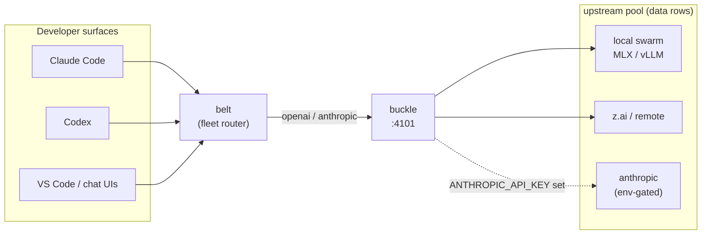

# buckle

> Part of the klh fleet monorepo — the system overview (packages, flow
> diagrams, laws, ops) lives at the fleet root: [README.md](../../README.md).

LLM gateway: multi-provider serving + governance in one Bun/TypeScript
process. Two client wire dialects (OpenAI, Anthropic) in front of the
LiteLLM-internal engine (W219.1) and the 100+ provider catalog
(W150) — the serving layer of the
[klh agent stack](https://github.com/klh/fleet/tree/main/packages/suspenders) — belt routes,
buckle serves.



## What it does

- **Two client wires, many providers** — OpenAI `/v1/chat/completions`
  and Anthropic `/v1/messages` are the client-facing dialects; behind
  them the LiteLLM-internal engine routes to 100+ providers as data rows
  (`upstreams.yaml` + the W150 catalog), not two hardwired backends.
  The native dialect-translation tier (W426) lets any request reach any
  deployment through the tool/stream transforms (`src/bridge.ts`):
  anthropic client ↔ openai upstream, both directions, JSON + streaming.
  Pass-through-first: same-dialect hops rank first, cross hops follow.
- **Upstreams are data, not code** — `upstreams.yaml` group rows
  (`url`, `dialect`, `adapter`, `api_key_env`), the same move LiteLLM's
  own long tail made (`openai_like/providers.json`). The provider catalog
  (W150) carries 100+ providers as rows; unknown providers ride the
  `openai-compat` catch-all with `adapter_config`.
- **Cloud rows ship dormant** — committed rows are env-gated: a deployment
  with `api_key_env: ANTHROPIC_API_KEY` activates only when that variable
  exists at runtime. Keys never live in committed files.
- **Ladder routing** — ordered fallback walk per `routing-policy.yaml`,
  retry with retry-after honoring, cooldown ejection after repeated
  failures, hour-bucket usage ledger.
- **Governance seams** — budgets, per-key/team ceilings, entitlement
  checks and federation hooks hang off the router core (see the suspenders
  design docs).
- **Repo-policy gate (W7)** — hub-connected sessions check the repo in
  view against `repo-policy.yaml` data rows (`{id, repoClass, detect,
check, missingQuestion, policySource}`): silent when satisfied, one
  actionable missing-question per found gap. `POST /repo-policy/check`
  or `bun bin/repo-policy.ts <repo-root> [--resolve-facts]`. Internal
  policy text stays in LOCAL-ONLY coord facts (`fact:finding.ikea-*`),
  resolved only on the local owner-report path.

## Status

Live on `127.0.0.1:4101` — the `resolvePort` startup guard refuses :4100
from any source (`src/server.ts`), that port stays the belt/litellm tier.
The scripted :4100 cut-over was superseded 2026-10-07 (W413) before it
ran: `docs/cut-over-runbook.md` is retained as the historical record,
outcome in the suspenders cut-over record it links.

## Run

```sh
bun install
bun run src/server.ts        # binds the configured port (loopback default)
bun test                     # adapter, ladder and citizenship suites
```

`upstreams.yaml` documents the row format inline. Override at runtime with
`BUCKLE_UPSTREAMS=/path/to/extra.yaml` (merged by group name; never
committed).

Egress law (startup-fatal, `src/adapters/egress.ts`): upstream `url`s are
https, or plain http to a loopback literal; other plain-http hosts must be
listed in `BUCKLE_HTTP_UPSTREAM_HOSTS`. Azure/Vertex `token_host` must be
https and on the family allowlist (extend with `BUCKLE_TOKEN_HOSTS`);
loopback token mocks need `BUCKLE_TOKEN_HOST_LOOPBACK=on`.

## Transport evidence

The existing admin trace join returns each attempt's `transport` observation:
wire request byte count, response header/first-byte offsets, response bytes and
chunks, and the locally observed timeout phase/budget and cancellation state.
Unknown or custom transports remain `null`. Boundaries update the same attempt
row; chunks do not create a new log or metric series. These are wire byte counts,
not prompt tokens or model prefill timing.

`x-klh-transport-timeout-phase` carries a bounded local timeout phase on failure;
only explicitly configured Buckle peers may relay it. Stream-close evidence is
available in the trace after headers, never retroactively promised in headers.
`local_settled` means the local fetch/reader cancellation promise settled. It
never proves that LiteLLM or the external provider stopped work:
`providerCancellationAcknowledged` remains `null`.

## Design sources

- `packages/suspenders/docs/design/buckle/routing-laws-2026-10-01.md` —
  the belt grammar + routing laws, native in the router
- `packages/suspenders/docs/design/buckle/gateway-repair-2026-10-01.md` —
  the belt gateway repair lane that preceded the native router
- `packages/suspenders/docs/design/buckle/cut-over-record-2026-10-02.md` —
  the cut-over outcome record

License: see [LICENSE](LICENSE). The LiteLLM provider docs vendored under
[docs/providers/](docs/providers/README.md) remain MIT — their license text
ships alongside ([LICENSE-litellm](docs/providers/LICENSE-litellm)). Litellm
internals were studied as documentation only; no code was copied.
