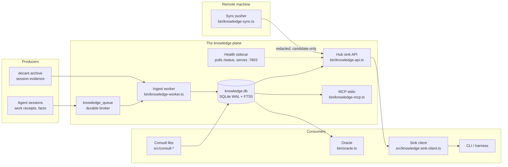

# Architecture

fleet-knowledge is one SQLite database, one ingest pipeline, and a set of
faces over them. Everything else is a client.

## Storage

**knowledge.db — `src/knowledge-db.ts`.** The schema home. SQLite in WAL
mode; `BEGIN IMMEDIATE` keeps concurrent writers honest. The knowledge
rows live in `knowledge` (append-only rows, state transitions mutate only
`state` and stamps), with an external-content FTS5 virtual table
`knowledge_fts` over `(topic, fact, domain, area, origin_kind,
origin_system, state)` kept in sync by triggers. Aggregated cross-machine
claims live in `knowledge_claims` (content-addressed by claim hash,
versioned, tombstone-able). The queue (`knowledge_queue`) and proposals
(`knowledge_proposals`) are durable, inspectable brokers — producers
INSERT even when the worker is down.

**Store port — `src/sqlite-store.ts`.** The only code that writes
knowledge rows. Everything else — HTTP face, MCP face, CLI, worker —
consumes the port. Search is bm25 rank + age penalty + origin prior over
live states; retired and buried rows never rank.

## Ingest

**Worker — `bin/knowledge-worker.ts`.** A long-running drain loop over the
queue, concurrency 1 (the distill model is single-instance — queue, never
parallel-stomp it). Each pass: claim a queue row, distill it through the
gated LLM boundary, clamp the canon (topic ≤80 chars, fact ≤400,
confidence 0..1), run the mechanical redaction pass (`redact.ts`), gate on
near-duplicates (older row kept, skip noted), apply the substitution
contract (never store what one doc already teaches — pointer-ize to
`source_ref` plus the non-obvious residue, or reject), land the row as
`state='candidate'`. `--once` drains and exits; the daemon polls.

**Redaction — `src/redact.ts`.** The rule engine. A mechanical secrets
pass runs before any insert; a private-key block rejects the whole
candidate rather than redacting in place. The sync layer uses the stricter
boundary posture: any hit rejects the row outright.

## Faces

**Hub sink — `bin/knowledge-api.ts`.** The HTTP face. `/search` is
anonymous and scrubbed (refs/hashes removed from unauthenticated output);
`/knowledge/query` translates natural language to SQL through a pinned SQL
LLM and executes under a QUERY_-scoped key; `/knowledge/sql` is direct
parameterized read-only SQL under a READ_-scoped key; `/status` and
`/metrics` are the observability pair; the `/ae/*` faces are anti-entropy
(see below). Mutating routes need the per-install write token; every
request passes the host guard. Full table in [faces.md](faces.md).

**Health sidecar.** A server cannot paint itself healthy. Compose runs a
second container that polls `http://knowledge-sink:7802/status` every 10s
and serves the verdict on :7803; orchestrator healthchecks hit the sidecar,
never the served process.

**MCP — `bin/knowledge-mcp.ts`.** One read-only tool, `read_knowledge`,
over the MCP stdio transport: prose cards with trust markers and a
precedence preamble, for any harness.

**Client — `src/knowledge-sink-client.ts`.** The one client for the sink's
recall faces: bounded, fail-open (a sink miss or partition never breaks
the local read it backs), key-file aware.

## Sync

**Pusher — `bin/knowledge-sync.ts`.** Spoke→hub replication, deny-by-
default: aggregate metrics cross by policy, content crosses only after
local verification, and every crossing lands CANDIDATE on the hub — the
wire can never activate a row. Claims ride a content-addressed roll
authenticated by per-machine TTL keys (sha256 stored, printed once).
Details in [knowledge-sync.md](knowledge-sync.md).

**Anti-entropy — merkle.** Hub-to-hub convergence rides a merkle tree over
the claims store: `/ae/root` compares roots (equality short-circuits —
identical hubs never exchange a row), `/ae/shard` descends differing
subtrees, `/ae/leaves` fetches and `/ae/merge` lands diffs, all
token-gated. This replaces timestamp-wins reconciliation with a
deterministic diff.

## Consolidation and decay

Corrections create NEW rows via `supersedes_id`; merged twins are marked
`duplicate_of`; history stays walkable. The decay sweep scores rows on an
exponential half-life (un-reviewed rows decay faster) and opens
`knowledge_proposals` — proposals are gate-free, disposal is a human act.
The engine never retires anything by itself.

## Distill

The session→knowledge-graph pipeline: raw session evidence (receipts,
transcript-derived claims) is distilled into candidate claims with
provenance. The distiller extracts; it never judges truth. The prompt is
config-over-code (`KNOWLEDGE_PROMPT_FILE`); its sha256 is the parser
version recorded on reprocess checkpoints.

## Consult and oracle

**`src/consult-v2.ts`** — the pure state machine: consult classes
(interrupt vs btw), priorities, escalation, budget windows. Zero I/O, so
it is table-testable. **`src/consult-config.ts`** — the zod knob schema
(config-over-code, JSON, loud on drift). **consult-oracle** — trust-tier
eligibility: which knowledge rows may answer a consult
(active+verified = trusted, candidate = unreviewed, drift/retired/demoted
= never), and the answer mark + feedback contract every knowledge answer
carries. **Oracle — `bin/oracle.ts`** — the review tool: fixed prompt
contract, two legs through one gated boundary. See [oracle.md](oracle.md)
and [consult-api.md](consult-api.md).

## Host-guard perimeter

`src/host-guard.ts` is the one guard every face rides: host allowlist on
EVERY request (reads included — DNS-rebind defense), Origin/Host equality
for browsers, and the per-install write token for mutating routes.
[SECURITY.md](../SECURITY.md) carries the honest threat model.
